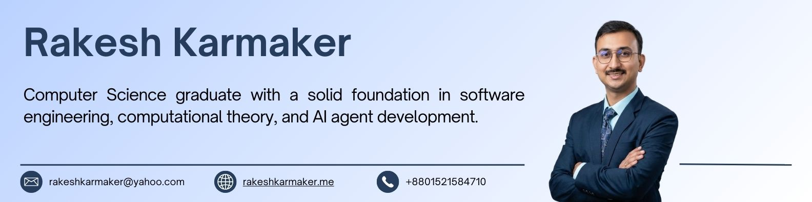

<!-- My Banner -->

  

<h1>Hello, I'm Rakesh Karmaker 👋</h1> 
<h3>Software Engineer | Full-Stack (NestJS,TanStack, Next.js, .NET) | AI/ML & LLM Researcher | NLP · GNN · Graph Theory</h3>

<!-- My Research Scopes-->
## 🌱 Currently Learning

> Exploring Applied AI systems and software engineering, Actively Developing Automation Systems leveraging my knowledge of Software, AI & IOT knowledge.

- ⚛️ **Advanced Software Engineering** — System Design, Distributed Systems, Software Architecture, Full Stack Dev.
- 🤖 **Applied Artificial Intelligence** — NLP, LLMs, RAG, AI Agents, and Intelligent Automation & Research.
- 🧮 **Advanced Algorithms & Computational Theory**
- 🕸️ **Graph Theory, Algorithms & Graph Neural Networks**
- 🔬 **Quantum Computing & Quantum Software Engineering**
- ⚛️ **AI × IoT — Intelligent Automation and Connected Systems**

## 🎓 Open to Opportunities

> Looking for research collaborations, and graduate opportunities in:

✨ **Applied Artificial Intelligence** • **Quantum Software Engineering** • **AI for Quantum Technologies** • **Graph Machine Learning** • **NLP** • **LARGE LANGUAGE MODEL**  

## 👨‍💻 Tech Stack & Skills

## 🛠️ Tech Stack & Technical Skills

### 💻 Programming Languages

  
  
  
  
  
  
  

### 🎨 Frontend Development & UI Engineering

  
  
  
  
  
  
  
  
  

### ⚙️ Backend Development

  
  
  
  
  
  

### 🏗️ Software Architecture & API Design

  
  
  
  
  
  
  
  

### 🗄️ Databases, ORM & Caching

  
  
  
  
  

### 🧠 AI, Machine Learning & Generative AI

  
  
  
  
  
  
  
  
  
  
  
  
  
  

### ☁️ DevOps, Cloud & Infrastructure

  
  
  
  
  
  
  
  
  

### 🔧 Development Tools & Version Control

  
  
  
  

## 🚀 Featured Projects & Research

| Project | Description | Tech Stack & Links |
|-------|-------------|-------------------|
| **Tourism Full Stack Web Application** | AI-assisted tour planning & booking platform with modular backend and recommendation chat | Next.js, NestJS, TypeScript, PostgreSQL, TypeORM, Gemini API   🔗 [Backend](https://github.com/rakeshkarmaker/tourism-web-application-Backend-api) \| [Frontend](https://github.com/rakeshkarmaker/tourism-web-application-Frontend) \| [UI Design](https://www.figma.com/design/8jNC9hxTPwpszJ6Ld2CRsB/Tour-Planner-Web-App-Design) |
| **DCS Club Alliance – Full Stack Platform** | Scalable club & event management system with enterprise backend architecture | Next.js 16, NestJS, PostgreSQL, Prisma   🔗 [GitHub](https://github.com/rakeshkarmaker) |
| **Event Management System (Next.js Full Stack)** | Modern full-stack app using experimental Next.js features with analytics | Next.js 16, MongoDB, TypeScript   🔗 [GitHub](https://github.com/rakeshkarmaker) |
| **Exam Management System – Backend API** | Enterprise-grade backend using 3-tier architecture and SOLID principles | ASP.NET Web API, EF, ADO.NET   🔗 [GitHub](https://github.com/rakeshkarmaker) |
| **Hospital Management System (Desktop)** | Windows desktop application for clinical & administrative workflows | C#, .NET Framework, WinForms, SQL Server   🔗 [GitHub](https://github.com/rakeshkarmaker) |
| **EcoCharge Hub – EV Station Platform** | Web-based platform for EV & environmental management | PHP, MySQL, MVC   🔗 [GitHub](https://github.com/rakeshkarmaker) |
| **Hotel Management System** | Java-based desktop system demonstrating OOP and file handling | Java, JavaFX   🔗 [GitHub](https://github.com/rakeshkarmaker/Hotel-Management-System-Final-Assemble) |
| **Empirical Study of BERT Variants** | Benchmarking BERT, DistilBERT & ALBERT for sentiment analysis | Python, HuggingFace, PyTorch   🔗 [GitHub](https://github.com/rakeshkarmaker) |
| **Brain Neurological Disease – GNN Benchmark** | Comparative benchmarking of GNN architectures on brain graph datasets | PyTorch Geometric, GNN   🔗 [GitHub](https://github.com/rakeshkarmaker) |
| **Royal Bengal Tiger Image Feature Extraction** | Image feature engineering pipeline for wildlife research | Python, OpenCV   🔗 [GitHub](https://github.com/rakeshkarmaker/royal-bengal-tiger-image-feature-extraction) |

## 📜 Research Contributions
- Empirical study on **BERT, DistilBERT & ALBERT** with model compression and efficiency analysis  
- Benchmarking **Graph Neural Networks (GNNs)** for neurological disease classification  
- Image feature engineering & computer vision pipelines for wildlife research  
- Exploration of **LLM-assisted systems and RAG-based architectures**

## 📈 GitHub Stats  

  
  

#

  

## 🤝 Get In Touch

  
  
  

  <i>Looking Forward to software engineering & AI Engineering opportunities, collaborations, and interesting ideas.</i>

